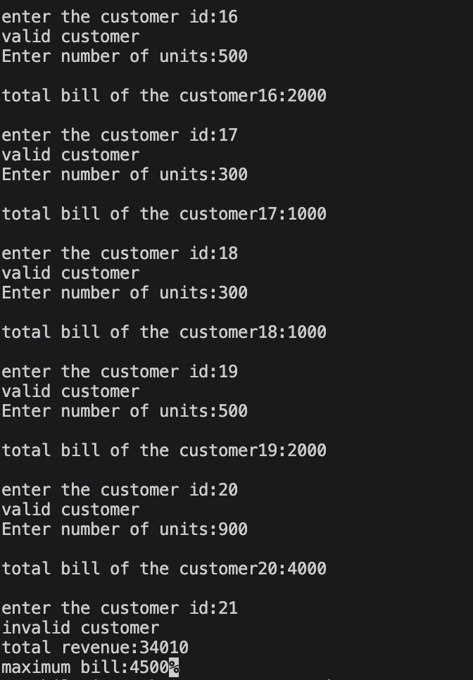

Smart Electricity Billing System

1. About the Project
This project is developed using C programming to simplify electricity bill calculations for 20 households.

2. Problem Statement
Manual bill calculations take time and may lead to errors. This project automates the process based on electricity consumption.

 3. Objectives
- Automate bill calculations.
- Calculate charges based on units consumed.
- Find total revenue.
- Identify the highest bill.

 4. Technologies Used
- C Programming
- Visual Studio Code

5. Tariff Structure

| Units | Rate |
|---|---|
| First 100 | ₹2/unit |
| Next 100 | ₹3/unit |
| Above 200 | ₹5/unit |

 6. Features
- Customer ID and unit input.
- Automatic bill calculation.
- Total revenue calculation.
- Highest bill identification.

7. Working
The program accepts customer details, calculates electricity charges for 20 entries, and displays the total revenue and highest bill.

   
 8. Sample Output

### Screenshot 1 – Program Execution

### Screenshot 2 – Billing Details

### Screenshot 3 – Final Output

 9. Future Improvements
- Store customer records.
- Generate individual bills.
- Add a graphical interface.

 10. Conclusion
This project helped me apply C programming concepts such as loops, conditions, and calculations to a real-world problem.

